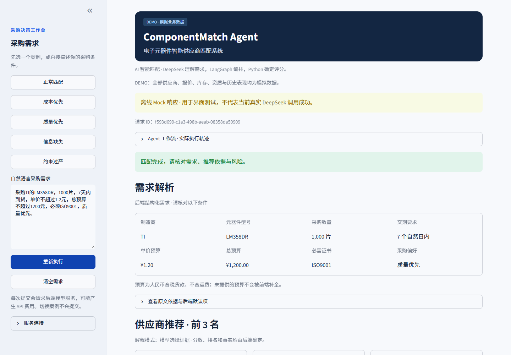
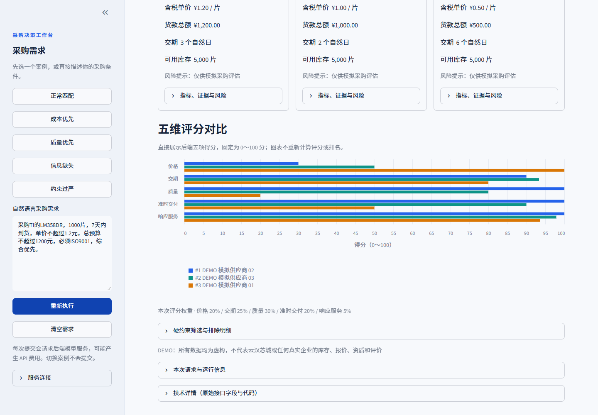
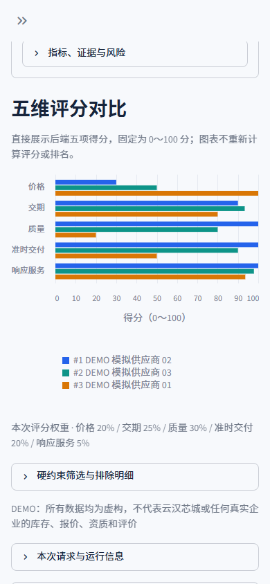

# ComponentMatch Agent

电子元器件供应商匹配 Demo：输入中文采购需求，DeepSeek 提取条件，LangGraph 编排，Python 完成硬筛、评分和排序，页面展示最多三家供应商及证据。

**所有供应商、库存、报价、资质和历史表现都是 DEMO 数据。** 本项目用于学习和面试演示，结果不是实际采购承诺。

## 界面预览

下面是本地浏览器验收的 **DEMO / 显式 Mock** 截图，不表示当前真实 DeepSeek 调用成功。截图不包含凭据或真实采购数据，来源见 [图片说明](docs/images/README.md)。



<details>
<summary>查看评分图表和手机宽度展示</summary>





</details>

## 新电脑第一次启动（Windows / PowerShell）

### 0. 克隆仓库（已有源码可跳过）

先安装 [Git for Windows](https://git-scm.com/download/win)，确认 `git --version` 能正常显示版本。在 GitHub 仓库页面复制 HTTPS 地址，选择本机一个父目录，在 PowerShell 执行：

```powershell
$repositoryUrl = Read-Host '粘贴 GitHub 仓库 HTTPS 地址'
git clone $repositoryUrl componentmatch-agent
Set-Location componentmatch-agent
```

已有复制或下载的源码时，直接在其根目录打开终端。以下命令都在**项目根目录**执行，也就是能看到 `README.md`、`backend`、`frontend` 和 `scripts` 的目录。

### 1. 安装 uv

如果 `uv --version` 能显示版本，跳过安装。否则在 PowerShell 执行官方安装命令：

```powershell
powershell -ExecutionPolicy ByPass -c "irm https://astral.sh/uv/install.ps1 | iex"
```

安装后关闭终端，重新打开 PowerShell，再进入项目目录，确认：

```powershell
uv --version
```

安装来源：[uv 官方安装说明](https://docs.astral.sh/uv/getting-started/installation/)。首次安装需要网络；uv 会按项目配置准备 Python 3.11，不需要提前安装 Python、Conda、Node.js 或数据库服务。

### 2. 重建这台电脑自己的环境

```powershell
powershell -NoProfile -ExecutionPolicy Bypass -File .\scripts\setup.ps1
```

这个脚本根据 `uv.lock` 创建两个互相独立的环境：

- `.venv-backend`：后端、模型和数据库依赖。
- `.venv-frontend`：Streamlit 页面、HTTP 客户端和接口契约。

如果没有 `.env`，会从空密钥模板创建一份；已有 `.env` 保留。此步骤不修改数据库、不调用模型。

**从旧电脑复制来的 `.venv` 不能直接使用。** 它可能保存旧电脑的绝对 Python 路径。新脚本不使用它；即使电脑上已有其他版本 Python 或 Conda，也直接使用上述新环境。

### 3. 配置后端密钥并准备数据

```powershell
notepad .env
```

填写自己的 `DEEPSEEK_API_KEY`，保存文件。其余参数通常保持默认：

```dotenv
DEEPSEEK_API_KEY=在本地填入自己的密钥
DEEPSEEK_BASE_URL=https://api.deepseek.com
DEEPSEEK_MODEL=deepseek-flash
DATABASE_URL=sqlite:///./data/componentmatch.db
```

不要把真实密钥提交到 Git 或发给别人。模型名称可以按自己的账户可用模型修改；这里的默认值不保证账户可用性。

然后初始化 DEMO 数据库：

```powershell
.\.venv-backend\Scripts\python.exe scripts/seed_demo.py
```

首次运行创建六张表和模拟数据；已有同版本完整数据库会显示 `unchanged`，不会覆盖或刷新报价时间。如果复制过来的数据库已过期，按 [数据说明](data/README.md) 创建新的演示库。

没有模型密钥也能启动页面和查看接口文档，但自然语言匹配会明确提示后端缺少凭据。

### 4. 启动前后端

```powershell
powershell -NoProfile -ExecutionPolicy Bypass -File .\scripts\start_demo.ps1
```

看到启动成功提示后，用浏览器打开：

- 页面：[http://127.0.0.1:8501](http://127.0.0.1:8501)
- 接口文档：[http://127.0.0.1:8000/docs](http://127.0.0.1:8000/docs)
- 进程健康检查：[http://127.0.0.1:8000/health](http://127.0.0.1:8000/health)

启动终端需要保持打开，按 **Ctrl+C** 停止本次启动的两个服务。启动器会先检查端口、数据库可读性和报价时效；不会自动删除旧库或结束占用端口的其他进程。

**只有提交、重新执行或确认采购条件才会调用模型，可能产生 API 费用。** 安装、灌入模拟数据、启动、健康检查和切换案例均不调用模型。

如果 8000 或 8501 被占用：

```powershell
powershell -NoProfile -ExecutionPolicy Bypass -File .\scripts\start_demo.ps1 -ApiPort 8001 -UiPort 8502
```

此时打开 [http://127.0.0.1:8502](http://127.0.0.1:8502)，启动器会自动让前端连接 8001。

## 以后每天怎么启动

完成首次准备后，只需要进入项目目录，运行：

```powershell
powershell -NoProfile -ExecutionPolicy Bypass -File .\scripts\start_demo.ps1
```

不用激活虚拟环境，不用再次灌入数据。启动会核对锁定的依赖。修改 `.env` 后重启后端生效。

只检查环境与数据，不启动服务：

```powershell
powershell -NoProfile -ExecutionPolicy Bypass -File .\scripts\start_demo.ps1 -CheckOnly
```

检查两个服务能够启动、连通并自动停止：

```powershell
powershell -NoProfile -ExecutionPolicy Bypass -File .\scripts\start_demo.ps1 -SmokeTest -ApiPort 18011 -UiPort 18511
```

这些检查不会验证真实模型可用性，也不会调用模型。

## 分别安装、分别启动

前后端是独立的 Python 包、依赖集合和进程，仅通过 HTTP JSON 通信。保留 Streamlit 前端，不需要安装 Node.js。两端共用的 `componentmatch-contracts` 只依赖 Pydantic；前端不导入后端包，不访问 SQLite，不持有 DeepSeek 密钥。

后端只需：

```powershell
powershell -NoProfile -ExecutionPolicy Bypass -File .\scripts\setup.ps1 -Target Backend
powershell -NoProfile -ExecutionPolicy Bypass -File .\scripts\start_backend.ps1 -ApiPort 8000
```

另开一个终端，前端只需：

```powershell
powershell -NoProfile -ExecutionPolicy Bypass -File .\scripts\setup.ps1 -Target Frontend
powershell -NoProfile -ExecutionPolicy Bypass -File .\scripts\start_frontend.ps1 -UiPort 8501 -ApiUrl http://127.0.0.1:8000
```

前端启动器清理继承的环境变量，不读取后端 `.env`。当前本机 Demo 只允许连接 localhost/loopback HTTP 地址；尚未提供公网部署或跨机器访问配置。

也可以直接使用各自的解释器（无需 PowerShell 脚本执行权限）：

```powershell
.\.venv-backend\Scripts\python.exe scripts/start_backend.py --port 8000
# 在另一个终端执行：
.\.venv-frontend\Scripts\python.exe frontend/run.py --port 8501 --api-url http://127.0.0.1:8000
```

## 页面怎么用

1. 选择一个案例，或输入完整需求，例如“采购TI的LM358DR，1000片，7天内到货，单价不超过1.2元，必须ISO9001，质量优先”。
2. 点击“开始匹配”，核对后端识别的型号、数量、交期、预算和资质。
3. 需要澄清时，可以补充文字；也可以展开“逐项确认有歧义或缺失的条件”，选择字段、填写值，再明确点击确认。
4. 查看供应商卡片、分项评分、排除原因、数据库证据与风险。

逐项确认只覆盖所选字段，不会自动取消无法验证的硬条件。更换原文后，旧确认值不会带到新需求。交期下限等不支持的表达应直接修订原文。

模型负责需求理解和选择解释证据；硬筛、分数、排名和事实由 Python 决定。解释失败或没有可用正向理由时使用事实模板，并明确显示来源。页面出现 Mock 标记时表示测试模拟，不代表真实 DeepSeek 调用成功。

## 常见问题

| 现象 | 处理方法 |
| --- | --- |
| 提示找不到 uv | 安装 uv 后重新打开终端，执行 `uv --version` 确认 PATH 生效。 |
| 原 `.venv` 报 `uv trampoline failed` 或找不到 Python | 不再使用拷贝来的环境，重新执行 `scripts/setup.ps1`。在 IDE 中选择 `.venv-dev` 或对应独立环境的解释器。 |
| PowerShell 提示禁止执行脚本 | 使用本文的 `powershell -NoProfile -ExecutionPolicy Bypass -File ...`，只对本次子进程生效，无需修改系统执行策略。 |
| 下载依赖失败 | 检查网络和代理后重跑 setup；已下载内容会复用。不要复制其他电脑的虚拟环境作为修复。 |
| 数据库不存在、表不存在 | 从根目录执行 `scripts/seed_demo.py`，确认 `.env` 中 DATABASE_URL 指向同一数据库。 |
| 数据时效合格报价为 0 | 旧库已过期。按 data/README.md 新建专用库并修改 DATABASE_URL；重复 seed 不会刷新旧报价。 |
| 页面可开，但无法连接后端 | 确认后端终端仍运行，ApiUrl 与 ApiPort 一致；先访问 `/health`。 |
| `CONFIG_MISSING` | 后端 `.env` 未填密钥；填写并重启。 |
| 认证、余额或模型配置失败 | 检查后端密钥、账户余额和模型权限；不要把密钥填到前端。 |
| 超时 | 页面不自动重试。先检查后端日志，避免连续重复付费提交。 |
| 没有推荐 | 核对结构化条件和排除原因；库存、MOQ、交期、预算、证书及报价时效都可能导致无匹配。 |
| 端口被占用 | 用 `-ApiPort`、`-UiPort` 换端口；脚本不会结束其他程序。 |

一键启动日志写入 `logs/demo-时间-进程号/`；分别启动时日志直接显示在各自终端。排错可提供请求 ID 和错误码，不要提供密钥或 `.env` 内容。

## 目录和职责

```text
ComponentMatch Agent/
├── backend/
│   ├── pyproject.toml
│   └── src/componentmatch/       # API、Agent、LLM、数据库、评分和服务
├── frontend/
│   ├── pyproject.toml
│   ├── app.py                   # Streamlit 入口
│   ├── run.py                   # 独立前端启动器
│   └── src/componentmatch_frontend/
├── packages/contracts/          # 两端共享的 HTTP 请求与响应契约
├── scripts/                     # 安装、启动、灌数、离线检查
├── tests/                       # 单元和集成测试，默认禁止外部模型请求
├── data/                        # 本机 SQLite 数据库（不提交）
├── docs/                        # 架构、规则和历次验证记录
│   ├── history/                 # 已归档的阶段报告
│   └── images/                  # 可公开的 DEMO / Mock 截图
├── .github/                     # CI、Issue 与 PR 模板
├── .gitattributes               # Git 文本与换行规则
├── .editorconfig                # 编辑器默认格式
├── .env.example                 # 空密钥配置模板
├── pyproject.toml               # uv workspace 和开发工具配置
└── uv.lock                      # 三个包共用的锁文件
```

运行环境分别是 `.venv-backend` 和 `.venv-frontend`；开发测试使用 `.venv-dev`。这些目录、`.uv-cache`、`.env`、本机数据库和日志都不应提交或复制到另一台电脑作为运行环境。

## 开发与测试

安装包含两端和测试工具的独立开发环境：

```powershell
powershell -NoProfile -ExecutionPolicy Bypass -File .\scripts\setup.ps1 -Target Dev
.\.venv-dev\Scripts\python.exe -m pytest -q
.\.venv-dev\Scripts\ruff.exe check backend frontend packages scripts tests
.\.venv-dev\Scripts\ruff.exe format --check backend frontend packages scripts tests
.\.venv-dev\Scripts\python.exe scripts/check_docs.py
uv --cache-dir .uv-cache lock --check
```

测试使用临时 SQLite、固定测试时钟和显式 FakeTransport，默认阻止外部 HTTP 请求；不需要真实 API Key，不修改现有 DEMO 库。

当前离线回归基线为 **403 项通过**。还实际验证了“只复制源码到新目录 → 安装 → 建库 → 启动”的全过程，范围见 [验证索引](docs/verification.md)。如需自行复验（会安装依赖，但不调用模型）：

```powershell
.\.venv-dev\Scripts\python.exe -m tests.clean_install_check
```

从根目录使用 uv 原生命令时，请显式选择环境，例如：

```powershell
$env:UV_PROJECT_ENVIRONMENT = '.venv-dev'
uv --cache-dir .uv-cache run --locked pytest -q
```

不要把新旧环境混用。根目录直接 `uv run` 默认选择 `.venv`，新电脑建议优先使用本文脚本和明确的解释器路径。

GitHub CI 会在 push / PR 时于 Windows / Python 3.11 执行离线测试、Ruff、文档链接和锁文件检查，不需要配置模型密钥。首次远端执行结果以上传后的 Actions 页面为准。协作流程见 [贡献说明](CONTRIBUTING.md)，首次提交与推送见 [GitHub 上传指南](docs/github.md)。

## 后端接口与规则

- `GET /health`：进程存活，不代表数据库或模型可用。
- `POST /api/v1/agent/matches`：自然语言 AI 工作流，输入 `text`，可附 `confirmed_fields`。
- `POST /api/v1/matches`：保留的确定性结构化接口，不调用模型；示例可在 `/docs` 查看。

金额用人民币分；单价上限和总预算独立检查，含税货款、不含运费。单型号精确匹配，不自动推荐替代料，不拆单、不超量买入。默认评分权重为质量30%、价格20%、交期25%、历史交付20%、响应5%，沿用既有规则。

请求使用协作式预算，同步数据库线程不能强制中断。任意自然语言仍不能保证完全正确提取，必须核对页面展示的条件。当前仅本机 Demo，未增加生产权限、审计持久化和并发限流。

更多说明：[架构](docs/architecture.md)、[数据准备与换库](data/README.md)、[评分规则](docs/scoring_design.md)、[后端开发](backend/README.md)、[前端开发](frontend/README.md)、[验证索引](docs/verification.md)、[历史报告](docs/history/README.md)。历史报告保留原执行结果，其中的旧目录和启动命令以本 README 为准。
