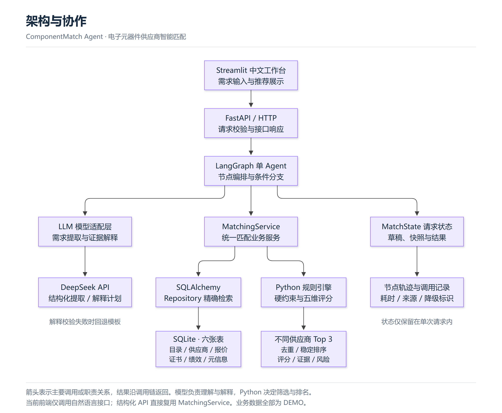
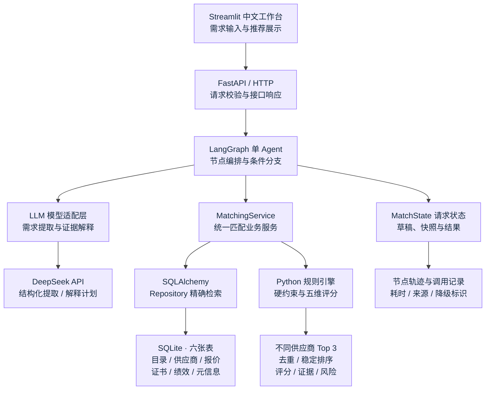
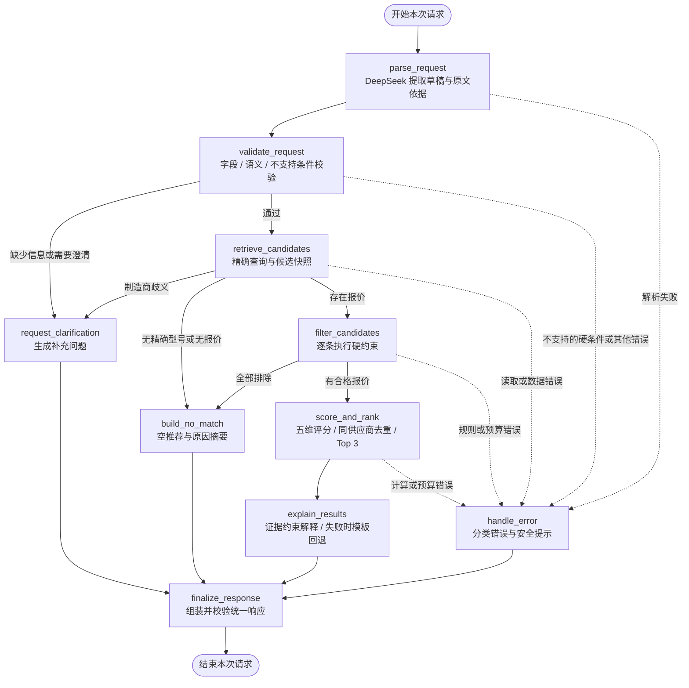
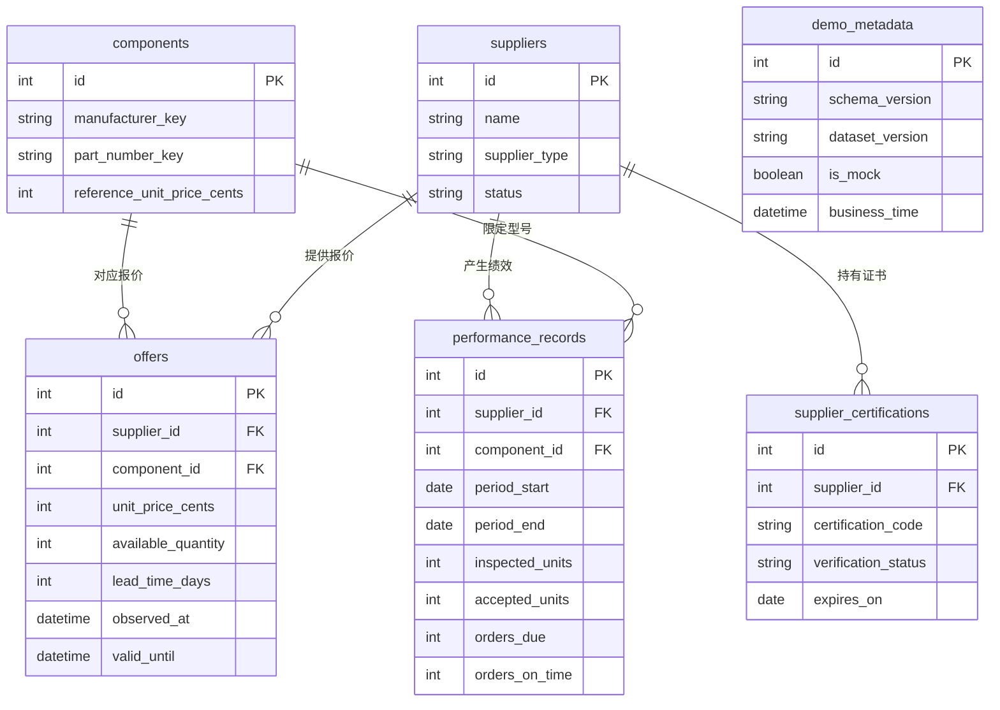

# ComponentMatch Agent 架构设计

本文基于当前仓库实现，说明电子元器件供应商匹配 Demo 的架构与设计思路。核心链路是：**自然语言采购需求 → 结构化校验 → 精确检索 → 硬约束过滤 → 确定性评分 → 不同供应商 Top 3 → 证据解释**。

系统采用单 Agent、有限步骤的工作流。DeepSeek 负责理解需求和组织解释，Python 负责业务规则与排名。所有库存、报价、供应商与历史绩效均为 DEMO 数据，结果用于演示采购辅助决策。

## 1. 总体架构图

采用纵向层级、浅紫色方框和分支箭头，展示主要调用及职责关系。业务结果沿调用链返回前端；此图是模块架构，具体执行顺序见下一节工作流图。

[查看高清矢量图](docs/architecture-overview.svg) · [查看 Mermaid 源文件](docs/architecture-overview.mmd)

展开可编辑的 Mermaid 架构图

当前前端只有自然语言入口，所有业务提交均调用 Agent API。结构化 API 继续作为独立的确定性接口保留，直接复用 `MatchingService`，无需经过模型。前端不直连数据库或 DeepSeek，模型密钥由后端持有。

这是一个模块化的 Python 项目，运行时分为 Streamlit 和 FastAPI 两个本地进程，数据库为 SQLite 文件。默认仅绑定本机回环地址；没有引入微服务、消息队列或分布式任务系统。

## 2. Agent 工作流图

节点名称与 `backend/src/componentmatch/agent/graph.py` 中的编译图保持一致。

工作流有四种业务终态：`success`、`needs_clarification`、`no_match`、`error`。缺信息时结束本次执行，等待用户补充；当前页面将补充文本合并回需求后重新提交，生成新的请求 ID。API 与页面都支持通过 `confirmed_fields` 显式确认所选字段；更换原文后清除旧确认值。

`MatchState` 保存草稿、结构化需求、候选快照、过滤结果、评分、解释、调用记录和节点轨迹，不存放数据库 Session、客户端或密钥。当前没有持久化 checkpointer，不提供跨重启的流程恢复。

## 3. 数据关系图

图中仅列出关键字段，完整定义见 [数据库设计](docs/database_design.md)。`demo_metadata` 是独立的单行数据集元信息表，不与业务表建立外键；其中的快照时间不替代系统当前业务时间。

报价关联精确元器件与供应商，历史绩效也限定在“供应商 + 型号”范围内，避免将其他型号的表现直接套用。证书独立存储有效期和核验状态，公司类型标签不能证明具体品牌授权。

## 4. 设计思路与关键取舍

### 4.1 将语言理解与采购决策分开

自然语言输入灵活，但采购匹配需要明确的型号、数量、交期和预算。模型先将原文提取为草稿，Python 再执行 Pydantic 校验、原文依据检查及有限的词法完整性检查。条件不全则追问，不支持的硬条件则阻止匹配；合法 JSON 本身不能证明需求提取完整，前端仍展示解析结果供用户核对。

模型不能决定候选、权重、分数或排名。这样可以在同一结构化需求、数据快照、业务时间和规则版本下复现计算结果，也便于针对边界条件做测试。

### 4.2 用显式工作流管理分支

匹配步骤相对固定，主要变化是缺条件、无候选、全部被排除和解释失败。LangGraph 用状态与条件边表达这些分支，节点只做编排，实际检索、过滤、评分交给 `MatchingService`。

采用一个有限步骤的单 Agent，能够直接展示每一步的轨迹与结果。结构化入口和自然语言入口共用业务服务，避免维护两套不同的采购规则。

### 4.3 精确查询结构化数据

元器件以归一化厂家和完整料号识别，型号后缀也是身份的一部分。当前数据规模小、字段结构明确，SQLAlchemy + SQLite 足以支持查询和演示；模糊相似度不能证明器件可替代，因此当前不使用向量检索进行型号匹配。

Repository 在短只读事务中读取目录、报价、证书与历史，转为独立 DTO 后关闭事务。后续计算与模型解释使用这些快照，避免等待外部 API 时持续占用数据库事务。

### 4.4 先满足硬条件，再比较优劣

硬筛检查精确型号、供货状态、数据有效性与时效、库存、MOQ、包装倍数、交期、单价上限、总预算和必需证书。任一硬条件失败，该报价就不能进入评分；无合格候选时返回排除原因，不自动放宽需求。

合格报价按五个维度计算 0～100 分，默认权重如下：

| 维度 | 权重 | 主要依据 |
| --- | ---: | --- |
| 质量 | 30% | 同型号历史检验合格率 |
| 价格 | 20% | 报价与有效参考价的关系 |
| 交期 | 25% | 报价到货自然日数 |
| 历史准时交付 | 20% | 同型号按时足量交付比例 |
| 响应服务 | 5% | 历史首次有效响应耗时 |

总分为各分项与权重的乘积之和。采用固定锚点归一化，新增候选不会改变其他候选的分项分数；缺失历史保守计分，小样本维度封顶，不将其权重转移给其他指标。金额使用整数人民币分，评分使用 `Decimal` 和六位计算精度。

按总分、质量分、交期、总货款、供应商 ID、报价 ID 依次稳定排序，每家供应商取最佳一条报价，最终最多返回三家。权重、锚点与阈值均为演示假设，详细规则见 [评分设计](docs/scoring_design.md)。

### 4.5 让推荐理由能够回查证据

Python 先构造评分、事实、证据 ID 和风险；模型仅选择合法指标、证据引用及表达顺序。解释计划经过白名单、归属和风险完整性校验后，由 Python 事实模板渲染，不能新增供应商或修改数值。

当解释调用超时或输出校验失败时，系统保留已经计算出的排名，改用模板解释，并返回 `explanation_mode=template`。解析阶段失败则返回错误，因为此时还没有可信的结构化需求可供计算。

### 4.6 使故障与结果可区分

| 场景 | 处理方式 |
| --- | --- |
| 缺字段、厂家歧义 | 返回补充问题，等待用户明确 |
| 未知型号、无报价、全部硬筛失败 | 返回 `no_match` 和实际原因 |
| 原厂授权等本版无法验证的硬条件 | 返回明确错误，不默默忽略 |
| 模型解析失败、数据库故障 | 返回 `error` 与错误码，不伪装成无匹配 |
| 推荐解释失败 | 保留分数和排名，回退模板 |

模型适配器统一管理有限重试，避免 SDK 与工作流重复重试。Agent 默认请求预算为 90 秒，但同步计算和已经启动的数据库线程不能被强制中断，因此它是协作式预算，不承诺严格的 HTTP 墙钟上限。前端 HTTP 不自动重试，防止超时后重复提交模型请求。

响应包含 `request_id`、`node_trace`、`llm_calls`、规则与数据版本等信息，便于定位耗时、调用来源与解释降级。日志避免记录密钥、完整 Prompt 和原始需求；`/health` 仅检查进程存活，不代表模型或数据库已验证可用。

## 5. 代码模块对应关系

下列后端路径均相对于 `backend/src/componentmatch/`。

| 模块 | 入口或关键文件 | 职责 |
| --- | --- | --- |
| 展示层 | 根目录 `frontend/app.py`、`frontend/api_client.py` | 输入、补充、HTTP 调用、证据展示 |
| API 层 | `api/main.py`、`api/agent_routes.py`、`api/routes.py` | HTTP 接口、依赖注入、响应与错误映射 |
| 编排层 | `agent/graph.py`、`agent/nodes.py`、`agent/state.py` | 图构建、受控节点、请求内状态 |
| 模型层 | `llm/client.py`、`llm/parser.py`、`llm/explainer.py` | DeepSeek 适配、提取校验、受限解释 |
| 业务服务 | `services/matching.py` | 统一检索、过滤、评分、去重与结果聚合 |
| 规则层 | `scoring/constraints.py`、`scoring/engine.py`、`scoring/weights.py` | 硬筛、评分公式、排序、权重版本 |
| 数据层 | `db/repositories.py`、`db/session.py`、`models/catalog.py` | 查询、事务、连接与六表定义 |
| 公共契约 | `packages/contracts/` | 两端共享的输入输出模型；配置、时钟和身份归一化仍在后端 `core/` |

## 6. 当前边界与后续演进

当前版本实现本地采购匹配与解释，不自动下单、锁价、预留库存或判断替代料兼容性，也没有生产级鉴权、并发限流、持久化请求审计和跨重启恢复。

后续应由具体需求驱动扩展：接入真实数据时增加来源核验、更新策略与迁移管理；多人使用时评估 PostgreSQL、访问控制和限流；需要长期回查时保存需求、数据快照、规则版本与结果；需要规格文档检索时再评估 RAG，并单独建立替代料审核流程。以上属于后续方向，并非当前已经实现的能力。

更多实现细节见 [系统架构](docs/architecture.md)、[需求与边界](docs/requirements.md) 和 [AI 单入口验证记录](docs/history/ai_only_verification.md)。
