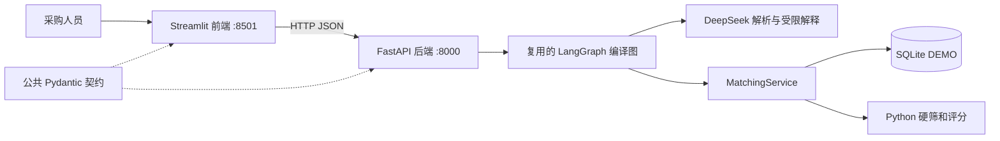
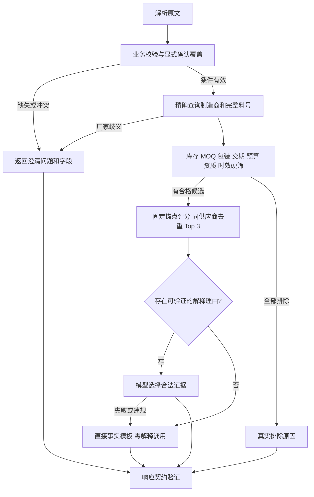

# 系统架构与前后端分离

当前结构：2026-10-23 改造版。前端、后端和公共 HTTP 契约是三个独立 Python 包，使用不同运行环境。首次安装和启动以 [根 README](../README.md) 为准；早期阶段报告保留历史结果。

## 运行与依赖边界

| 包 / 目录 | 职责 | 独立环境 |
| --- | --- | --- |
| `frontend/src/componentmatch_frontend/` | 输入、澄清、HTTP 客户端、中文结果和图表 | `.venv-frontend` |
| `backend/src/componentmatch/` | FastAPI、Agent、模型、数据库、硬筛与评分 | `.venv-backend` |
| `packages/contracts/src/componentmatch_contracts/` | HTTP 请求/响应与一致性验证；只依赖 Pydantic | 两端各自安装 |
| 根目录开发工作区 | pytest、Ruff、两端联合开发 | `.venv-dev` |

前端不导入后端包、不直连 SQLite 或 DeepSeek。模型密钥仅在后端 `.env` / 进程环境中，前端启动用白名单清理继承环境。Streamlit 的 HTTP 调用发生在前端服务器进程，因此本机运行无需浏览器跨域配置。当前地址仍限制为本机 HTTP，没有新增公网部署能力。

各成员有自己的 `pyproject.toml`，共用根 `uv.lock`；setup 显式选择包并安装到不同虚拟环境。参考 [uv workspace 官方说明](https://docs.astral.sh/uv/concepts/projects/workspaces/)。

## 后端依赖方向

API → Agent → LLM / MatchingService → Repository → ORM / SQLite。
MatchingService 调用纯函数硬筛与评分；公共契约不反向依赖业务层。数据库内部 DTO 留在后端 `schemas/snapshot.py`。

应用生命周期中延迟创建并复用编译图和模型客户端；请求状态、单调时钟预算、调用列表和轨迹独立。服务关闭时释放拥有的 SDK 连接和数据库 engine。数据库读取在短事务中生成快照，事务结束后再等待模型解释。

## 工作流

未展示的异常边统一返回分类错误；不把数据库故障当作无匹配。模型不能改变候选、分数、权重或排名。

解析分为数字/金额、日期和语义三个辅助模块。有限语义检查区分必需/可选资质，以及交期上限/下限；“7天后”不能转换为“7天内”，“不要求原厂授权”不会成为授权硬条件。不同子句的强制要求仍单独阻断。任意自然语言仍可能有未覆盖表达，页面必须展示提取结果供核对。

## 澄清与界面状态

后端返回 `clarification_questions` 和 `clarification_fields`。页面提供两条明确操作：补充文字后重新解析；或选中字段、填值并提交 `confirmed_fields`。确认值只覆盖对应字段；不自动确认，也不能绕过无法验证的硬条件。

每次提交产生新请求 ID。相同原文重新执行可复用已经明确确认的字段；原文改变后清除旧确认值。会话只保存在内存，不承诺跨重启恢复。主界面仍只有自然语言入口，结构化 API 是后端独立能力。

## 时间、评分与诊断

默认业务时钟使用实际 UTC，证书日期和月份按 Asia/Shanghai 判断；Windows 后端显式安装 tzdata。FixedClock 仅用于显式测试模式。种子日期不会替代当前日期，重复灌数不刷新旧报价。启动器只读统计报价和证书时效，不自动改库。

评分规则和默认权重保持既有设计：质量30%、价格20%、交期25%、历史交付20%、响应5%。使用 Decimal、固定锚点、固定同分排序，最多三家不同供应商。详情见 [评分设计](scoring_design.md)。

日志记录请求 ID、节点、耗时、错误码、异常类型、候选数和模板原因，不记录异常正文、采购原文、Prompt 或密钥。请求预算为协作式，同步线程不能强制取消；解释失败保留已有分数并回退模板。生产鉴权、限流和持久化审计仍未实现。
