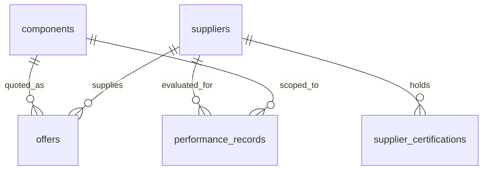

# 数据库设计

版本：v0.2。已使用 SQLite + SQLAlchemy 2 实现六张表，字段沿用第一阶段，无新增或删除字段。
约束补充为可执行 CHECK、唯一键与外键，全部数据通过 is_mock=true、DEMO 来源标签标记。
供应商为12家虚构供应商，6个元器件、18条供货记录、11张模拟证书、66条月度历史。

## 1. 关系与建模粒度

五张业务表加一张单行 `demo_metadata`。offers 实现供应商与元器件的多对多关系。
绩效精确到供应商 + 元器件 + 自然月，避免拿其他型号的表现直接证明本型号可靠。
证书单独建表，支持同一家多张证书、有效期与验证状态；不把资质压成一个无法核验的总分。
请求、评分结果和聊天记录不在本版持久化；结果响应包含本次证据与配置快照。

## 2. 通用类型与约束

- ID 为 SQLite INTEGER 主键；关系字段 NOT NULL，外键 RESTRICT，避免隐式级联删除证据。
- 金额用整数“分”，数量用整数 pcs；计算时使用 Python Decimal，不用 FLOAT 存金额。
- 时间戳使用 UTC，SQLite 以 SQLAlchemy DateTime 存储约定为 UTC 的值，读写适配器负责
  规范化和恢复时区，不能假定 SQLite 自动保留时区。证书、月度窗口使用 DATE。
- 每张业务表含 `is_mock BOOLEAN NOT NULL CHECK(is_mock=1)`、`source_label TEXT NOT NULL`、
  `created_at DATETIME NOT NULL`、`updated_at DATETIME NOT NULL`。
  `source_label` 使用 `DEMO:DEMO-v2`，CHECK 要求 DEMO 前缀，不是外部认证地址。
- 布尔值 CHECK 为 0/1；状态用字符串 + CHECK 枚举；正数/比例与字段关系由 CHECK 和
  Pydantic 双层校验。跨表/跨行约束由种子校验与服务层校验，不声称 SQLite CHECK 可跨表。
- 为区分未知与 0，允许未知业务指标为 NULL；0 库存明确表示无货，NULL 表示未知。
  数据缺失处理见评分设计，禁止把 NULL 当作无限库存或 0 天交期。

## 3. components：元器件目录

| 字段 | 类型 / 约束 | 说明 |
| --- | --- | --- |
| id | INTEGER PK | 元器件身份 |
| manufacturer | TEXT NOT NULL | 展示名称 |
| manufacturer_key | TEXT NOT NULL | 受控厂家名称归一化键 |
| part_number | TEXT NOT NULL | 原始完整制造商料号 |
| part_number_key | TEXT NOT NULL | 去首尾空白、ASCII 大写后的完整料号 |
| category | TEXT NOT NULL | 如 IC、阻容；只展示不用于推断替代 |
| package | TEXT NOT NULL | 封装展示与输入冲突检查，不推断兼容 |
| description | TEXT，可空 | 简短描述；不直接作为模型指令 |
| reference_unit_price_cents | INTEGER，可空；有值时 >0 | 固定评分参考价，非市场指导价 |
| reference_currency | TEXT NOT NULL，固定 CNY | 参考价币种 |
| reference_observed_at | DATETIME，可空 | 参考价时间；与参考价同时有值或同时为空 |

UNIQUE(manufacturer_key, part_number_key)。为 part_number_key 建索引供跨厂家歧义检查。
受控厂家别名映射先放在 Python 配置中并版本化；不使用 LLM 临时宣布两个厂家相同。
初版不建兼容关系表，因为本版不支持替代料。以后支持时应新增有方向的审核关系，
记录规格证据、限制、审核人、有效期与用户确认，而非相似度分数。

## 4. suppliers：供应商

| 字段 | 类型 / 约束 | 说明 |
| --- | --- | --- |
| id | INTEGER PK | 供应商 ID |
| name | TEXT NOT NULL UNIQUE | 必须为虚构名称，例如“模拟供应商 A” |
| supplier_type | TEXT NOT NULL | `manufacturer / authorized_distributor / independent_distributor`，均为模拟分类 |
| region | TEXT，可空 | 展示信息，不参与本版过滤 |
| status | TEXT NOT NULL | `active / suspended`；停用直接排除 |

`supplier_type` 不直接证明对某个品牌的授权，也不单独加分。
若未来要求品牌授权，应新增 supplier + manufacturer 粒度的授权记录，不复用公司级标签。
不存联系人姓名、手机号、账号等与本次 Demo 无关的信息。

## 5. supplier_certifications：供应商证书

| 字段 | 类型 / 约束 | 说明 |
| --- | --- | --- |
| id | INTEGER PK | 证据 ID |
| supplier_id | INTEGER FK → suppliers.id | 证书归属 |
| certification_code | TEXT NOT NULL | 受控代码，本版拟支持 ISO9001 |
| certificate_number | TEXT NOT NULL | 模拟编号，必须含 MOCK 前缀 |
| valid_from | DATE NOT NULL | 生效日期 |
| expires_on | DATE NOT NULL | 到期日期，>= valid_from |
| verification_status | TEXT NOT NULL | `verified / unverified / revoked`，verified 也只是模拟核验状态 |
| verified_at | DATETIME，可空 | verified 时必需且不晚于业务时钟 |

UNIQUE(supplier_id, certification_code, certificate_number)；
索引 (supplier_id, certification_code)。要求某代码时，必须至少有一张该代码证书满足
verified 且 valid_from ≤ business_date ≤ expires_on。未要求证书时不因无证书额外扣分，
但不得生成“资质已核验”的理由。ISO9001 不等同产品真伪或器件兼容性证明。

## 6. offers：供货记录 / 单条模拟报价

| 字段 | 类型 / 约束 | 说明 |
| --- | --- | --- |
| id | INTEGER PK | 报价证据 ID |
| supplier_id | INTEGER FK → suppliers.id | 供应商 |
| component_id | INTEGER FK → components.id | 报价精确元器件 |
| offer_code | TEXT NOT NULL | 单家供应商内唯一报价编号 |
| unit_price_cents | INTEGER，可空；有值时 >0 | 含税单价；不含运费，非实际交易报价 |
| currency | TEXT NOT NULL，固定 CNY | 本版拒绝跨币种 |
| available_quantity | INTEGER，可空；有值时 >=0 | 当前快照可承诺数量，不能跨记录求和 |
| min_order_quantity | INTEGER NOT NULL，>0 | MOQ |
| order_multiple | INTEGER NOT NULL，>0 | 下单数量必须为该倍数，不默认超购 |
| lead_time_days | INTEGER，可空；有值时 >=0 | 快照供货数量在下单后到货的自然日数 |
| observed_at | DATETIME NOT NULL | 库存、价格和交期共同的快照时间 |
| valid_until | DATETIME NOT NULL，>= observed_at | 报价有效截至时间，含边界 |
| status | TEXT NOT NULL | `active / withdrawn` |

UNIQUE(supplier_id, offer_code)；索引 (component_id, status)、(supplier_id, component_id)。
同供应商同型号允许多条独立报价，但不合并；先逐条硬筛和评分，再取该供应商的最佳一条。
同供应商报价同分时按同一排序键，最后 offer_id 升序取一条，不让一家占满 Top 3。
单条报价无阶梯价、批次成本合并、不同到货批次或预计补货；库存量对应可在该交期内供货的数量。

## 7. performance_records：本型号历史绩效（月度聚合）

| 字段 | 类型 / 约束 | 说明 |
| --- | --- | --- |
| id | INTEGER PK | 月度绩效证据 ID |
| supplier_id | INTEGER FK → suppliers.id | 被评估供应商 |
| component_id | INTEGER FK → components.id | 仅对该型号统计 |
| period_start | DATE NOT NULL | 自然月首日，含该日 |
| period_end | DATE NOT NULL，> period_start | 下月首日，不含该日 |
| quality_evaluated_orders | INTEGER NOT NULL，>=0 | 本月完成质检的订单数量 |
| inspected_units | INTEGER NOT NULL，>=0 | 本月实际检验件数，不用采购总量冒充 |
| accepted_units | INTEGER NOT NULL，0..inspected_units | 检验合格件数 |
| orders_due | INTEGER NOT NULL，>=0 | 本月应完成交付的订单数，包括已逾期未完成订单 |
| orders_on_time | INTEGER NOT NULL，0..orders_due | 本月应交订单中按时足量交付数量 |
| response_minutes_total | INTEGER NOT NULL，>=0 | 本月询价首次有效响应分钟数总和 |
| response_samples | INTEGER NOT NULL，>=0 | 响应统计样本数量，分母 |

UNIQUE(supplier_id, component_id, period_start, period_end)。月度窗口必须恰好为一个完整自然月；
同供应商同型号窗口不重叠，由导入校验保证。所有计数按各自事件所属月份计入，不能跨月重复累计。
没有质检订单时 inspected_units 和 accepted_units 必须为 0；有检验件数时
quality_evaluated_orders 必须 >0。response_samples=0 时 response_minutes_total 必须=0。
同一订单可分别参与质量、交付维度，两个维度不要求分母相等。

评分取业务日期之前最近六个完整自然月，例如业务日期为 2026-10-21 时，
窗口为 [2026-04-01, 2026-10-01)。只合并完整落在该窗口内的月度记录；
先加分子和分母再算比例，不能对月合格率直接求平均。
没有记录的月份不虚构为 100%；记录覆盖不足、样本不足、最近记录过旧均生成风险。
没有原始采购订单表，因此不能追溯到真实订单，本版仅能解释聚合计算与种子构造过程。

## 8. demo_metadata：单行模拟数据集元信息

| 字段 | 类型 / 约束 | 说明 |
| --- | --- | --- |
| id | INTEGER PK，CHECK(id=1) | 单行 |
| schema_version | TEXT NOT NULL | 数据表结构版本 |
| dataset_version | TEXT NOT NULL | 种子版本 |
| is_mock | BOOLEAN NOT NULL，CHECK=1 | 强制模拟标识 |
| business_time | DATETIME NOT NULL | 数据集生成时的业务快照时间；不作为服务当前时钟 |
| generated_at | DATETIME NOT NULL | 实际种子生成 UTC 时间 |
| description | TEXT NOT NULL | 虚构声明与使用场景 |

数据集缺少元信息、混入 is_mock=false、引用无效组件身份或不支持的币种等破坏全局不变式时，
返回 DATA_INVALID，不能继续输出看似可信的排名。单条报价数值缺失按硬筛排除；
单条历史无效则忽略该条、标记风险，剩余样本保守评分。

## 9. 查询、生命周期与种子验收

1. 使用参数绑定精确查询归一化厂家/料号；按报价取供应商、证书和同型号绩效，避免 N+1 查询。
2. 创建每个连接时启用 `PRAGMA foreign_keys=ON`；每请求一个 session、短只读事务快照。
3. 表和种子仅由显式脚本创建；API 导入、健康检查不建表、不联网。
4. 脚本在事务中校验与写入，固定业务 ID 或稳定唯一键；同版本重复执行不重复写入；
   已存在不同数据集必须明确报错，未来重置命令需显式指定，不自动删除旧库。
5. 已有测试覆盖唯一键、CHECK、外键、跨月去重、UTC 往返、过期边界和 NULL 语义。
6. 已实现种子：6个完整型号、12家虚构供应商、18条报价，覆盖三家合格供应商、
   同家多报价、不同后缀、库存不足、MOQ/倍数不满足、证书异常、报价过期与缺历史场景。
7. CLI 初始化使用实际生成时间；测试才传 test_business_time。重复初始化不刷新报价时间，
   避免将旧库存伪装成新数据；需要新数据时选用新的专用 DEMO 数据库路径，不自动重置旧库。

第一版采用 SQLAlchemy `metadata.create_all` + schema_version 检查，结构变更后重新生成专用 Demo 库；
不声称 create_all 可迁移已有字段。若开始保留真实业务数据，再引入 Alembic 与迁移策略。
